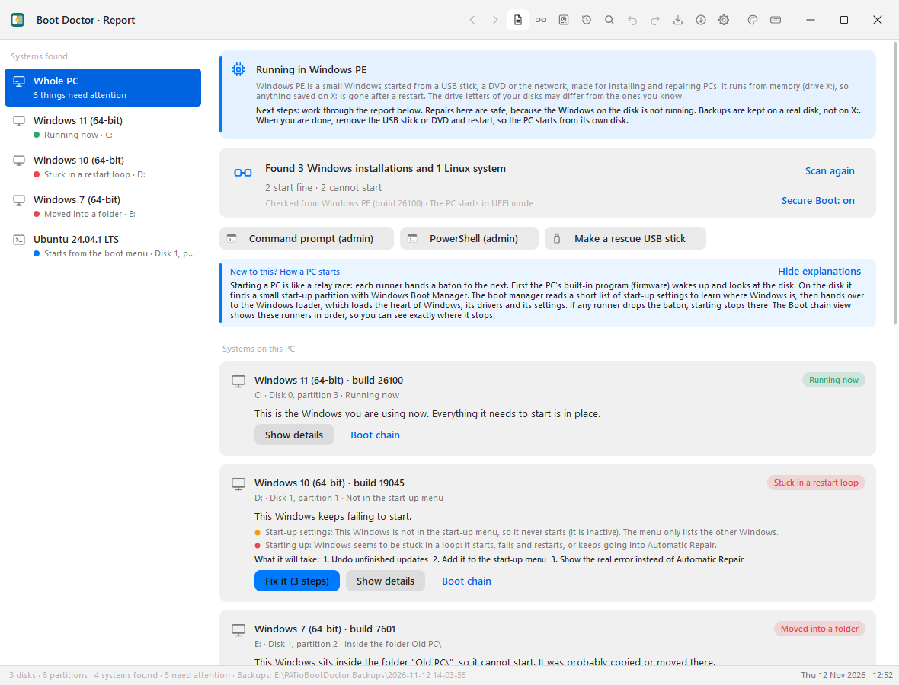
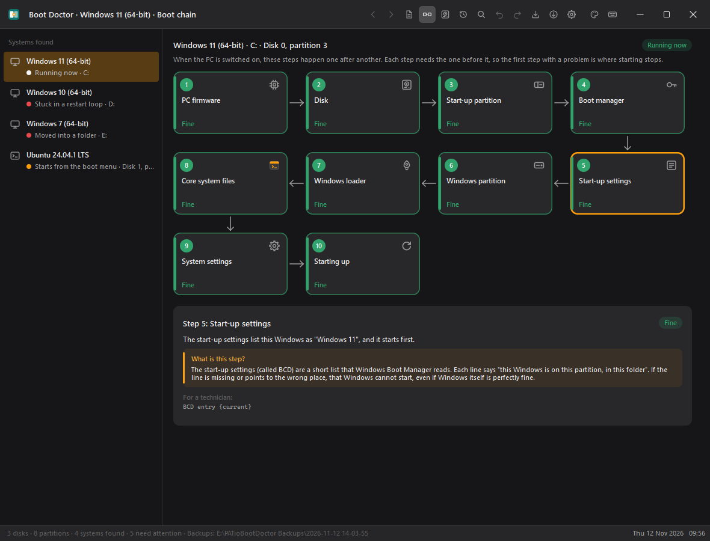
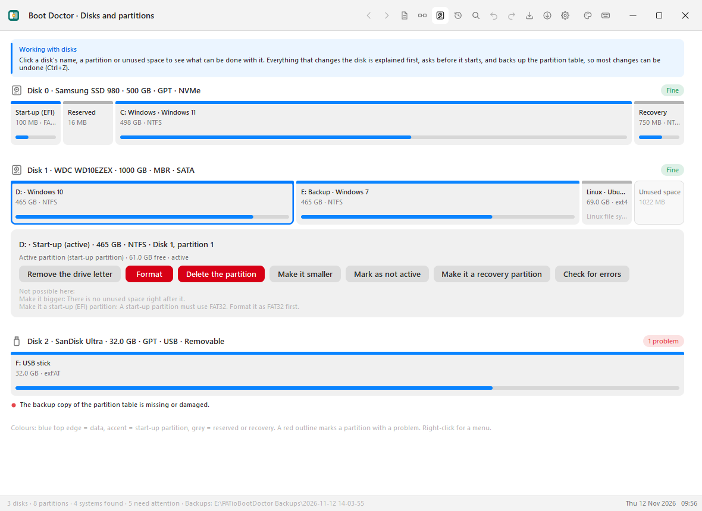
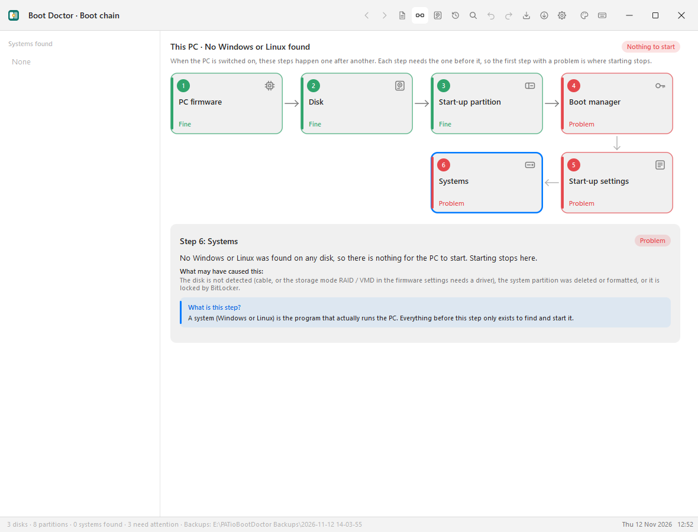

# PATio Boot Doctor

**When Windows won't start, this tells you why — in plain words — and fixes it.**

Boot Doctor looks at a PC that won't boot, finds the one thing that's broken, explains it the way you'd explain it to a customer, and offers to repair it. Every repair is described first, asks before it runs, and backs things up so it can be undone.

---

## Download

**[⬇ Download the latest version](../../releases/latest)** — one file, `PATioBootDoctor_x64.exe`.

Nothing to install. Download it, then right-click → **Run as administrator**. It runs on normal Windows, and also from a rescue USB stick, a Windows install disc, or Windows' own repair mode.

---

## What it shows you

**Every Windows on the PC, and whether each one can start.** It finds Windows even when it's been moved into a folder or left behind in `Windows.old`, and tells you, in one line, what each needs to boot.

**The boot chain — the 10 steps a PC goes through to start.** The first broken link is exactly where starting stops. No guessing.

**Every disk and partition, drawn out.** Sizes, file systems, which partition is the start-up one, BitLocker, and anything damaged — marked in red.

**Even when nothing is found.** If no Windows will start at all, it says so and lists the likely reasons — a loose cable, the wrong storage mode in the BIOS, a wiped partition, or BitLocker.

---

## What it can fix

Each fix is explained first, asks before it runs, and can be undone:

- **Rebuild the start-up files** (the usual "it just won't boot" fix)
- **Repair or rebuild a damaged EFI / start-up partition**
- **Put a Windows back in the start-up menu**, or make it start first
- **Stop a restart loop** (endless "Automatic Repair")
- **Turn the right storage driver back on** — the usual cause of `INACCESSIBLE_BOOT_DEVICE`
- **Unlock BitLocker, run a disk check, undo a half-finished update**
- **Move a Windows back out of a folder**, repair the partition table, and more

It also makes a **bootable rescue USB stick** (UEFI, Legacy, or both) so you can run Boot Doctor on a PC that can't start at all.

---

## Good to know

- **64-bit (x64) only.** Runs on Windows 7 SP1 through 11, plus WinPE, WinRE and Safe Mode.
- **Available in 15 languages**, built in.
- **Not code-signed yet**, so Windows SmartScreen may warn the first time — choose **More info → Run anyway**.
- Your own customer data (job notes, logs, saved keys) stays on your PC; it's never part of the program.

> The screenshots above use built-in **demo data**, not a real customer's PC.
